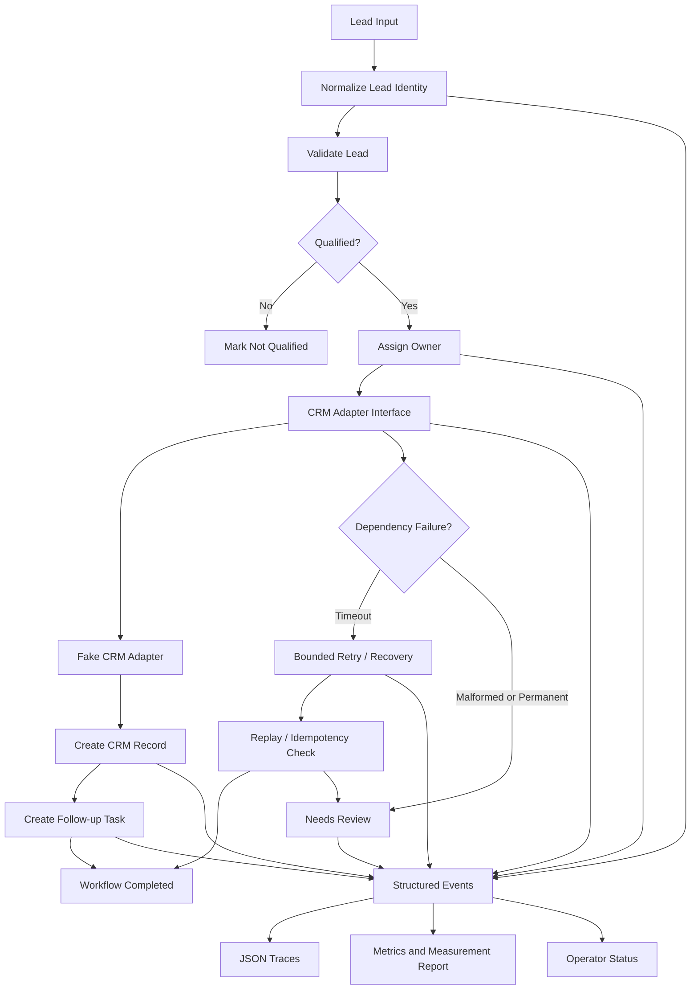

# CRM Automation — Architecture

## Main components

- **Lead processing:** Normalizes lead identity and validates required fields.
- **Qualification:** Evaluates the lead score and determines eligibility.
- **Assignment:** Assigns a sales owner based on qualification rules.
- **CRM adapter:** Separates external CRM operations from workflow logic.
- **Recovery:** Handles timeout, malformed response, permanent failure, and replay.
- **Observability:** Records structured events, execution metrics, and traces.
- **Operator interface:** Exposes dependency health, workflow status, and next actions.
